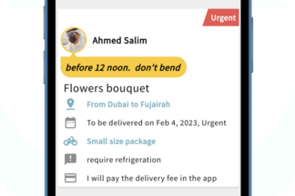

# Hi, I'm Ayman 👋

#### 📍 Dubai &nbsp;|&nbsp; 🛠️ Freelance builder

Software, tools, experiments, and the occasional questionable idea. I freelance on mobile apps, backends, and cloud infrastructure.

> Mostly solving problems. Sometimes creating new ones.

---

### 📱 On the Apple App Store

&nbsp;&nbsp;
&nbsp;&nbsp;

- **[Tuckmo](https://apps.apple.com/ae/app/tuckmo/id6833324502)**: Tuck it away. Find it again. Save links, posts and media from any app, synced via iCloud.
- **[FotoSlash](https://apps.apple.com/ae/app/fotoslash/id6756789131)**: Clean up your photo library with a swipe and free up storage.
- **[خط](https://apps.apple.com/ae/app/id591598742)**: Write on your photos in beautiful Arabic calligraphy.

### 💼 Freelance work

&nbsp;&nbsp;
&nbsp;&nbsp;
&nbsp;&nbsp;
&nbsp;&nbsp;

- **[Deliverit UAE](https://deliveritapp.ae/)**: Dubai's delivery platform, from mobile apps to cloud &nbsp;•&nbsp; *Builder & maintainer*
- **[Ramsatna](https://www.facebook.com/photo/?fbid=1546552272038268&set=a.307034059323435)**: Dubai Municipality's Emirati dialect dictionary &nbsp;•&nbsp; *Builder & maintainer*
- **[Sheikh Ebrahim Al Zaabi](https://ebrahimalzaabi.com/)**: The official site: Islamic rulings and scholarly works &nbsp;•&nbsp; *Builder & maintainer*
- **[SafeShare.tv](https://safeshare.tv)**: Distraction-free video sharing for education &nbsp;•&nbsp; *Founder & builder*
- **[Eco Yoga Sanctuary](https://ecoyogasanctuary.com/)**: Website, hosting and all the tech behind it &nbsp;•&nbsp; *Maintainer*

### ⭐ Featured

- 😈 **[spiteware.ai](https://spiteware.ai)**: A catalog of apps people built out of spite for overpriced software. Runs itself: a Claude Code agent finds, scores and lists new apps every morning, then renders and posts a daily short.
- 💬 **[WhatsKept](https://github.com/alkait/WhatsKept)**: Give your AI agent the power to find and send WhatsApp messages. Your full history in SQLite, with search over text, images, voice notes and PDFs.
- 📹 **[HikYeah](https://github.com/alkait/HikYeah)**: Hikvision software sucks. This is better. Written in Rust.
- ⚡ **[quickclaude](https://github.com/alkait/quickclaude)**: A Spotlight-style macOS launcher for Claude Code that uses your Claude subscription.

### 🌐 More apps

- **[Yesterdo](https://yesterdo.netlify.app)**: Be present. Make progress.
- **[سين جيم القرآن](https://seenjeem-quran.netlify.app)**: A Jeopardy-style Quran trivia party game for 1–4 players, built around المتشابهات.

### 🧰 Tools

- **[clay](https://github.com/alkait/clay)**: Disposable Claude Code playgrounds.
- **[claude-usage-for-humans](https://github.com/alkait/claude-usage-for-humans)**: Claude usage, for humans.
- **[whatsapp-web-zen](https://github.com/alkait/whatsapp-web-zen)**: A browser extension that declutters WhatsApp Web: hides Meta AI, channels and communities, and shows favorites on the start page.
- **[dotfiles](https://github.com/alkait/dotfiles)**: Herdr, Ghostty and AeroSpace config for macOS and Linux.
